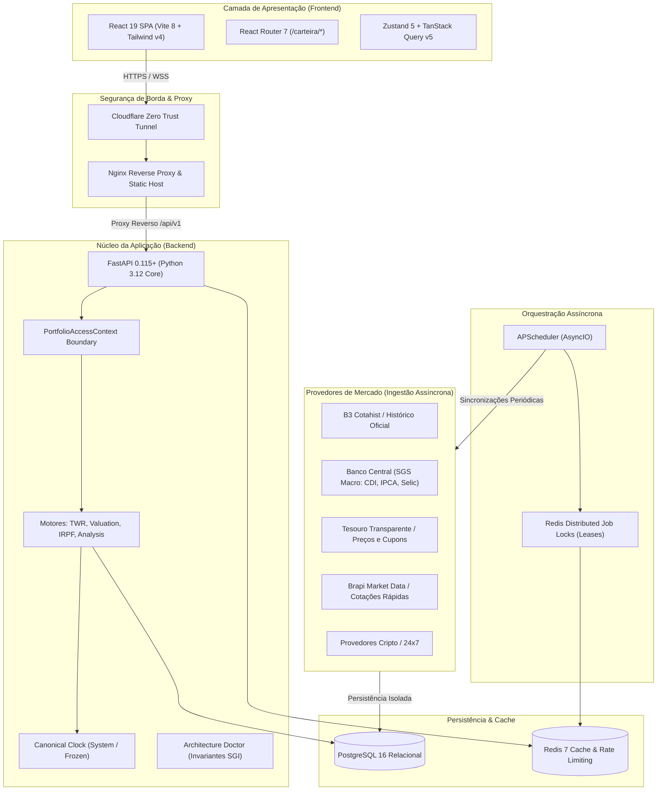
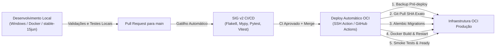

# SGI — Sistema de Gestão de Investimentos
## Documentação Oficial, Arquitetural e Operacional do Sistema

> **Status do Documento:** Oficial / Baseline de Produção  
> **Versão da Plataforma:** 2.0.0 (Release Contínuo — Branch `main`)  
> **Revisão Canônica do Banco:** Alembic Head `20261105_purge_cert_entities`  
> **Público-alvo:** Diretoria Executiva, Investidores, Gestores, Engenharia de Software, Segurança e Operações

---

## 1. Visão Geral e Posicionamento Institucional

O **SGI (Sistema de Gestão de Investimentos)** é uma plataforma tecnológica de nível institucional voltada à consolidação patrimonial, controle do livro-razão contábil, apuração rigorosa de rentabilidade real ponderada pelo tempo (TWR), acompanhamento de proventos e auxílio à conformidade fiscal de investidores pessoas físicas e gestores patrimoniais.

Diferente de agregadores convencionais que se limitam a consultar interfaces de terceiros ou raspar telas de corretoras, o SGI opera sobre os mais estritos princípios contábeis: **livro-razão financeiro canônico (ledger)**, **arquitetura DB-first**, **determinização temporal com relógio auditável**, **controle rigoroso de autorização por escopo de carteira** e **tolerância zero à inferência ou invenção de preços ausentes**.

### 1.1 Proposta de Valor e Diferenciais
- **Visão Patrimonial 360° Consolidada:** Acompanhamento unificado de ativos brasileiros (B3) e internacionais (mercado norte-americano em USD), além de títulos públicos, crédito privado e criptoativos.
- **Rentabilidade Ponderada no Tempo (TWR Real):** Neutralização total de distorções provocadas pelo volume e momento de novos aportes e resgates, comparando o desempenho real da gestão contra benchmarks de mercado (CDI, Ibovespa, IPCA).
- **Projeção Contábil Determinística:** Posições, custos médios, resultados realizados e lucros tributáveis derivam matematicamente das operações registradas no livro-razão cronológico.
- **Camada Dupla de Inteligência Artificial:** Análise diagnóstica executiva de carteiras sob demanda e assistente documental interativo integrado à Central de Ajuda com isolamento completo dos dados privados de custódia.
- **Governança e Segurança em Camadas:** Autenticação federada Google OAuth 2.0, duplo fator obrigatório via TOTP (MFA), controle progressivo contra força bruta, travas distribuídas via Redis e trilha de auditoria para todas as operações críticas.

---

## 2. Arquitetura da Solução e Stack Tecnológica

O SGI é concebido como uma arquitetura desacoplada de microsserviços e contêineres conteinerizados, orquestrados via Docker Compose, com separação nítida entre apresentação, lógica de domínio, persistência e automações de segundo plano.

### 2.1 Diagrama Geral da Arquitetura



### 2.2 Tecnologias Utilizadas

| Camada | Tecnologia / Versão | Papel na Plataforma |
| :--- | :--- | :--- |
| **Frontend Framework** | React 19 (`^19.3.1`), TypeScript 6 (`^6.0.3`) | Renderização de alta performance, tipagem estrita e reatividade. |
| **Frontend Bundler** | Vite 8 (`^8.3.4`) | Compilação ultraveloz, code splitting por rota e HMR instantâneo. |
| **Frontend Design** | Tailwind CSS v4 (`^4.3.3`), Lucide React | Design System consistente, tokenizado, com suporte nativo Dark/Light. |
| **Frontend State** | TanStack Query v5, Zustand 5 | Cache assíncrono de servidor e gerenciamento leve de estado global. |
| **Frontend Charts** | Recharts 3 (`^3.10.1`) | Visualizações gráficas interativas de patrimônio, alocação e retornos. |
| **Backend Framework** | FastAPI, Starlette, Pydantic v2 | API REST assíncrona, documentação OpenAPI sanitizada e serialização estrita. |
| **Backend Runtime** | Python 3.12 Slim (Linux Alpine/Debian) | Ambiente de execução determinístico de alto rendimento. |
| **ORM / Banco** | SQLAlchemy 2.0 (AsyncIO), `asyncpg`, PostgreSQL 16 | Banco relacional robusto com integridade referencial e transacional. |
| **Migrações de Schema** | Alembic (70 migrações lineares) | Evolução controlada, auditada e sem downtime de tabelas e índices. |
| **Cache & Locks** | Redis 7 Alpine | Rate limiting, sessões voláteis e locks distribuídos com TTL contra contenção. |
| **Agendador** | APScheduler (AsyncIOScheduler) | Execução de rotinas de fechamento, coletas horárias e manutenções locais. |
| **Borda e Rede** | Cloudflare Tunnel (`cloudflared`), Nginx | Exposição HTTPS segura sem portas públicas abertas na infraestrutura OCI. |

---

## 3. Invariantes Arquiteturais e Integridade Financeira

O SGI é regido por leis arquiteturais imutáveis monitoradas pelo **Architecture Doctor** (`backend/app/doctor/`):

### 3.1 Princípio DB-First Estrito
- As rotinas de consulta de tela (`GET /api/v1/...`) e cálculos financeiros operam **exclusivamente com dados persistidos localmente no PostgreSQL**.
- Provedores externos de mercado (APIs externas) nunca são chamados no caminho crítico de leitura do usuário, garantindo tempos de resposta sub-100ms e blindagem contra instabilidades de terceiros.
- Nenhuma informação ausente (preço, câmbio ou benchmark) é substituída por valor zero, cotação estimada ou paridade fixa. O sistema atua de maneira estritamente **fail-closed**, indicando lacunas de forma transparente.

### 3.2 O Livro-Razão Canônico (`transactions`)
- A tabela `transactions` é o livro-razão único e sagrado da plataforma.
- Saldos de custódia, posições de ativos, preços médios e lucros/prejuízos são **projeções matemáticas puras** derivadas das transações ordenadas cronologicamente.
- Não existem campos de "quantidade atual" com edição avulsa na carteira: qualquer alteração patrimonial requer uma transação de lastro válida (Compra, Venda, Desdobramento, Bonificação, Aporte, Resgate ou Amortização).
- **Autoridade Única de Escrita:** Somente o `TransactionWriteService` possui autorização para gravar lançamentos contábeis.

### 3.3 Relógio Canônico e Determinismo Temporal (`Clock`)
- Todos os módulos de cálculo de rentabilidade, proventos e fechamentos diários injetam o provedor `app.core.clock.Clock`.
- Em produção, opera com `SystemClock` (fuso oficial `America/Sao_Paulo`).
- Em ambientes de homologação, testes automatizados e reprocessamentos históricos, injeta-se `FrozenClock`, garantindo que os mesmos dados de entrada gerem rigorosamente os mesmos centavos de saída, eliminando qualquer dependência do relógio físico do servidor.

### 3.4 Autorização e Isolamento por Contexto (`PortfolioAccessContext`)
- Identificadores numéricos enviados pelo cliente (`portfolio_id`) não possuem autoridade intrínseca.
- O acesso a qualquer dado financeiro exige a validação formal de um objeto `PortfolioAccessContext`:
  - **Contexto de Usuário (`for_user`):** Comprova a identidade autenticada e a titularidade da carteira no repositório.
  - **Contexto Sistêmico (`for_system`):** Exige a declaração de uma finalidade operacional auditável (ex.: `portfolio_snapshot_auto_maintenance`), proibindo bypasses implícitos em tarefas assíncronas.

### 3.5 Regra Obrigatória de Documentação Contínua e Viva
- A cada nova instrução, implementação, correção de bug, refatoração de código, migração ou criação de rota/componente, **toda a documentação afetada DEVE ser rigorosamente atualizada no mesmo bloco de trabalho** (incluindo `README.md`, `docs/ROADMAP.md`, `docs/DOCUMENTACAO_DO_SISTEMA.md`, `backend/README.md`, `frontend/README.md` e arquivos de domínio).
- Nenhuma alteração no código é considerada concluída ou pronta para merge enquanto existir documentação divergente, omitida ou defasada.

---

## 4. Cobertura Multiclasse de Ativos

O SGI oferece cobertura nativa para as classes mais relevantes do ecossistema de investimentos:

| Classe | Código Enum | Moeda | Tratamento Financeiro e Particularidades |
| :--- | :--- | :--- | :--- |
| **Ações Brasileiras** | `ACAO` | BRL | Cotações diárias via B3, desdobramentos/grupamentos, normalização automática de mercado fracionário (ex.: unificação de lote padrão `PETR4F` $\rightarrow$ `PETR4`). |
| **Fundos Imobiliários** | `FII` | BRL | Renda passiva mensal, yield sobre custo (YoC), proventos isentos de IRPF para PF e múltiplos P/VP. |
| **Tesouro Direto** | `TESOURO_DIRETO` | BRL | Marcação a mercado diária oficial pelo Tesouro Transparente, cupons semestrais, cálculo TWR e amortizações. |
| **Renda Fixa Privada** | `RENDA_FIXA` | BRL | CDBs, LCIs, LCAs, CRIs, CRAs e Debêntures. Apuração de indexadores (CDI, IPCA, Pré), liquidez diária ou vencimento, e dedução tributária automática conforme taxonomia do produto. |
| **ETFs Nacionais** | `ETF_NACIONAL` | BRL | Índices B3 (ex.: BOVA11, SMAL11), cotação contínua e tributação sobre ganho de capital. |
| **BDRs** | `BDR` | BRL | Certificados de ativos globais negociados na B3 com proventos convertidos e tributáveis. |
| **Ações Internacionais** | `STOCK` | USD | Ações norte-americanas (NYSE/NASDAQ), consolidação com taxa PTAX oficial do Banco Central e acompanhamento de dividendos em moeda estrangeira. |
| **ETFs Internacionais** | `ETF_INTERNACIONAL` | USD | Fundos de índice globais em dólar (ex.: VOO, QQQ, IVV). |
| **Criptoativos** | `CRIPTO` | BRL / USD | Ativos digitais (Bitcoin, Ethereum, etc.) com negociação ininterrupta 24/7 e suporte a frações com alta precisão decimal. |

---

## 5. Mapeamento de Recursos e Telas da Aplicação

O sistema é navegado através do prefixo `/carteira/*`, garantindo contexto de portfólio persistente e intuitivo:

```text
/                                   Landing Page institucional e apresentação do SGI
/auth/login                         Acesso seguro com E-mail/Senha ou Google OAuth 2.0
/auth/registro                      Cadastro de novos investidores
/auth/esqueceu-senha                Recuperação de acesso com limitação de tentativas
/welcome                            Fluxo de Onboarding e criação da primeira carteira
/carteira                           Dashboard Principal / Visão Geral da Carteira Ativa
/carteira/patrimonio                Consolidação patrimonial detalhada e composição
/carteira/patrimonio/renda-variavel Custódia dedicada de Ações, FIIs, BDRs e ETFs
/carteira/patrimonio/tesouro        Títulos públicos, taxas contratadas e marcação a mercado
/carteira/patrimonio/renda-fixa     Títulos privados com indexador, emissor e garantias
/carteira/rentabilidade             Painel avançado de TWR, MWR e comparação com benchmarks
/carteira/transacoes                Extrato completo, filtros temporais e novos lançamentos
/carteira/proventos                 Calendário dinâmico, proventos provisionados e recebidos
/carteira/metas                     Alocação alvo estratégica e cálculo de rebalanceamento
/carteira/analise                   Análise patrimonial diagnóstica com síntese em IA
/carteira/ferramentas/rendimentos   Calculadora de juros compostos e aportes futuros
/carteira/ferramentas/renda-fixa    Simulador comparativo de títulos de Renda Fixa
/carteira/ferramentas/comparador    Comparador simultâneo de múltiplos ativos lado a lado
/carteira/ferramentas/analise-ativos Análise fundamentalista profunda por ativo com gráficos
/carteira/ferramentas/recomendacoes Carteiras recomendadas institucionais guiadas por IA
/carteira/irpf                      Radar Fiscal, ganhos de capital, isenções e informe anual
/carteira/ajuda                     Central de Ajuda e Assistente Documental com IA
/carteira/configuracoes             Perfil, segurança (MFA), gestão de carteiras e Admin
```

### 5.1 Destaques Funcionais das Principais Telas

#### Patrimônio e Eventos Corporativos (`PatrimonioPage.tsx` e `PendingCorporateFractionsPanel.tsx`)
- Visão detalhada de custódia consolidada dividida por classes de ativos (Ações, FIIs, BDRs, Renda Fixa, Cripto e Tesouro).
- **Painel de Eventos Corporativos e Leilão de Frações:** Exibe o histórico de eventos aplicados na carteira (grupamentos, desdobramentos, bonificações) e o ciclo de liquidação de resíduos fracionários decorrentes de eventos em bolsa, diferenciando com transparência valores já liquidados em leilão (`R$ X,XX (Leilão liquidado)`) de frações pendentes aguardando leilão (`A confirmar (Aguardando leilão)`).
- **Importação Resiliente de Extratos B3:** Motor adaptativo que segrega débitos de `Fração em Ativos` de ativos que sofreram grupamento (evitando dupla dedução em relação ao motor canônico) e desambigua devoluções de empréstimo de ações (BTC) através de encerramentos contratuais de empréstimo, assegurando a integridade contábil do preço médio mesmo durante períodos com contratos de aluguel ativos.

#### Dashboard e Resumo (`ResumePage.tsx`)
- Indicadores em tempo real de Patrimônio Total, Lucro/Prejuízo Total, Variação do Dia e Proventos acumulados.
- Gráfico de Evolução Patrimonial histórico contínuo com suporte a finais de semana e ponto intradiário em tempo real (alinhamento imediato com as cotações do pregão corrente).

#### Extrato de Transações (`Transacoes.tsx`)
- Histórico completo com paginação e ordenação por data, ativo, tipo de operação e corretora.
- Filtro temporal dinâmico por período (Mês Atual, Ano Atual, 12 Meses ou Intervalo Customizado).
- Modal de lançamento enriquecido com:
  - Máscara monetária decimal com preenchimento natural da direita para a esquerda em padrão Real (R$).
  - Suporte formal a lançamentos com custo R$ 0,00 (bonificações de ações, doações, transferências de custódia).
  - Suporte a alta precisão decimal para ativos fracionados e criptomoedas.
  - Normalização automática de ativos da B3 (reconhecimento e agrupamento de códigos com final `F`).
- Seleção múltipla por checkboxes e exclusão em lote de lançamentos ou por classe/grupo filtrada (`POST /api/v1/portfolios/{id}/transactions/bulk-delete`), com reconstrução de snapshots serializada e coalescida em segundo plano.

#### Rentabilidade Avançada (`RentabilidadePage.tsx`)
- Implementação rigorosa do método **Time-Weighted Return (TWR)**, recomendação internacional do CFA Institute (GIPS).
- Comparações instantâneas contra CDI, Ibovespa e IPCA ao longo de janelas temporais configuráveis.
- Expurgo contábil de fluxos externos de caixa para demonstrar a eficiência pura da seleção de ativos.

#### Proventos e Fluxo de Caixa (`ProventosPage.tsx`)
- Linha do tempo de proventos recebidos no passado e provisionados para datas futuras (Dividendos, JCP, Rendimentos de FIIs e Cupons do Tesouro).
- Yield on Cost (YoC) real calculado sobre o preço médio histórico da custódia.
- Notificação matinal automática por e-mail dos proventos agendados para pagamento no dia.

#### Conjunto de Ferramentas e Simuladores (`/carteira/ferramentas/*`)
1. **Simulador de Renda Fixa:** Compara rendimentos brutos e líquidos entre títulos pré-fixados, pós-fixados (CDI) e híbridos (IPCA+), aplicando automaticamente a tabela regressiva de IRPF ou isenção conforme o tipo do ativo.
2. **Calculadora de Rendimentos:** Simula a curva de acumulação de juros compostos com aportes periódicos e reinvestimento de dividendos.
3. **Comparador de Ativos:** Permite selecionar até 5 ativos de classes diferentes e compará-los lado a lado em termos de múltiplos de valuation (P/L, P/VP, Dividend Yield, ROE, Margem Líquida) e rentabilidade histórica recente.
4. **Página de Análise de Ativos:** Página dedicada de mergulho profundo em qualquer ativo cadastrado, com gráficos temporais de cotação, histórico de distribuição de proventos e múltiplos fundamentalistas.
5. **Carteiras Recomendadas por IA:** Alocações institucionais de referência formuladas para três teses estratégicas centrais:
   - *Patrimônio:* Foco em preservação de capital e valor real (Renda Fixa defensiva, Tesouro e Blue Chips).
   - *Proventos:* Foco em renda passiva mensal imediata e previsibilidade de caixa (FIIs e Ações de dividendos).
   - *Performance:* Foco em valorização exponencial de longo prazo (Small Caps, Tech e Criptoativos).
   - Possui simulador integrado que calcula a quantidade exata de compra de cada ativo a partir do capital informado pelo usuário.

---

## 6. Camada de Inteligência Artificial e Assistentes

O SGI adota Inteligência Artificial de ponta de forma estruturada, ética e determinística, dividida em dois assistentes independentes:

### 6.1 Análise Diagnóstica de Carteira (`AnalisePage.tsx`)
- Opera sobre um **Data Transfer Object (DTO) determinístico** gerado pelo motor contábil do backend (`AnalysisEngine`).
- O backend calcula todas as métricas matemáticas (índice de concentração, alocação setorial, desvios da meta, exposição cambial e métricas de risco).
- A IA sintetiza esses dados em linguagem natural na forma de um diagnóstico executivo com:
  - Pontos fortes da carteira;
  - Riscos identificados (ex.: sobrepeso em determinado ativo ou setor);
  - Recomendações estratégicas de rebalanceamento.
- **Blindagem Matemática:** A IA não realiza cálculos nem inventa números; ela interpreta a verdade contábil já calculada pelo motor interno.

### 6.2 Central de Ajuda & Assistente Documental (`HelpPage.tsx`)
- Atua na rota `/carteira/ajuda` como copiloto de navegação e suporte operacional.
- Treinado sobre o corpus documental institucional higienizado (`backend/help_docs/`).
- Capacidades:
  - Responde dúvidas sobre o funcionamento de qualquer cálculo, regra fiscal ou menu do sistema;
  - Aponta as fontes documentais exatas (arquivo, seção e citação textual);
  - Fornece atalhos visuais dinâmicos (`suggested_routes`) para que o investidor acesse a página relevante com um clique;
  - Possui limite de requisições integrado (10 requisições/minuto por IP) para proteção contra abusos.
- **Privacidade Assegurada:** O assistente não possui acesso ao banco de transações, saldos ou dados sigilosos do investidor.

---

## 7. Orquestração Assíncrona e Automações de Segundo Plano

As tarefas em lote e rotinas de manutenção periódica são gerenciadas pelo **APScheduler** no fuso horário de Brasília (`America/Sao_Paulo`). Para viabilizar execução confiável em contêineres e alta disponibilidade sem concorrência destrutiva, cada tarefa utiliza **travas distribuídas em Redis (`distributed_job_lock`)** com tempos de expiração (TTL) seguros.

### 7.1 Inventário de Tarefas Agendadas em Produção

| ID da Tarefa | Horário / Frequência | Descrição da Atividade Operacional |
| :--- | :--- | :--- |
| `update_quotes_intraday_full_hour` | Seg–Sex, 09h às 18h (hora cheia) | Atualização de cotações de mercado aberto (Ações, FIIs, BDRs, ETFs, Tesouro). Invalida caches dependentes. |
| `update_crypto_quotes_offhours_weekdays` | Seg–Sex, 00h–08h e 19h–23h (hora cheia) | Manutenção horária de cotações de criptoativos fora da janela do pregão da bolsa. |
| `update_crypto_quotes_weekends` | Sáb e Dom, 24 horas (hora cheia) | Manutenção contínua de cotações cripto durante os finais de semana. |
| `persist_daily_close_prices` | Seg–Sex, às 20h45 | Persistência definitiva dos preços de fechamento diário de todos os ativos com transações registradas. |
| `sync_benchmark_rates_daily` | Seg–Sex, às 08h40 e 20h40 | Sincronização dos índices macroeconômicos oficiais junto ao Banco Central (SGS): CDI, SELIC, IPCA e IGPM. |
| `sync_ibov_benchmark_daily` | Seg–Sex, às 08h42 e 20h42 | Sincronização da cotação oficial de fechamento do índice Ibovespa (^BVSP). |
| `persist_treasury_daily_close` | Seg–Sex, às 20h50 | Persistência dos preços unitários e taxas de fechamento de todos os títulos do Tesouro Direto. |
| `notify_daily_dividend_payments` | Seg–Sex, às 08h30 | Disparo de e-mail institucional matinal com o resumo dos proventos que caem na conta do investidor na data. |
| `sync_asset_dividends_morning` | Seg–Sáb, às 08h00 | Ingestão global de proventos anunciados pelas empresas e fundos (janela de -90 dias a +365 dias). |
| `sync_corporate_events_daily` | Seg–Sex, às 22h00 | Sincronização de eventos societários (desdobramentos, grupamentos, bonificações, fusões). |
| `portfolio_snapshot_auto_maintenance` | Diariamente, às 21h00 (inclui fins de semana) | Consolidação oficial do fechamento patrimonial diário e encadeamento da série temporal TWR das carteiras ativas. |
| `refresh_asset_fundamentals_daily` | Seg–Sex, às 21h30 | Atualização de métricas e múltiplos fundamentalistas (P/L, P/VP, DY, ROE, Margens e consenso de mercado). |
| `audit_b3_market_calendar_monthly` | Dia 01 de cada mês, às 08h15 | Auditoria read-only do calendário de feriados oficiais da B3 contra a fonte pública oficial. |

### 7.2 Painel de Controle e Disparo Manual (SuperAdmin)
- Localizado em **Configurações $\rightarrow$ Painel SuperAdmin $\rightarrow$ Tarefas Agendadas**.
- Permite aos administradores inspecionar o status de cada job, o timestamp da última execução com sucesso e falhas relançadas.
- **Disparo Manual Sob Demanda:** Qualquer tarefa pode ser executada manualmente via interface com um clique (`POST /api/v1/admin/scheduler/{job_id}/run`).
- **Histórico Completo de Execuções:** Registro detalhado com duração em segundos, data/hora e mensagem diagnóstica de cada execução recente (`GET /api/v1/admin/scheduler/{job_id}/history`).

---

## 8. Segurança, Governança e Controle de Acesso

O SGI atende aos mais rígidos padrões de segurança da informação e governança corporativa:

### 8.1 Autenticação e Credenciais
- **Senhas Criptografadas:** Hashing moderno via `bcrypt` com salting individualizado.
- **Google OAuth 2.0:** Suporte nativo a Single Sign-On (SSO) corporativo.
- **MFA / 2FA Obrigatório por TOTP:** Segundo fator via tokens temporais compatíveis com Google Authenticator, Authy e Microsoft Authenticator.
- **Tokens de Sessão JWT:** Tokens de acesso de curta duração (15 minutos) e Refresh Tokens rotativos persistidos de forma segura.

### 8.2 Proteção Contra Força Bruta e Ataques de Negação
- **Rate Limiting em Múltiplas Camadas:** Governança por IP e por conta via Redis (`SlowAPI`).
- **Bloqueio Progressivo de Recuperação de Senha:** Máximo de 2 solicitações em 2 minutos; a 3ª solicitação bloqueia automaticamente a emissão por 60 minutos com falha fechada (*fail-closed*).
- **Desbloqueio Administrativo:** O SuperAdmin possui a prerrogativa auditada de desbloquear contas legítimas com reset de tentativas e registro no log de segurança.

### 8.3 Trilha de Auditoria Geral (`audit_logs`)
- Registro imutável de todas as ações sensíveis realizadas no sistema:
  - Logins com sucesso e tentativas com senha incorreta;
  - Criação, edição e exclusão de transações;
  - Modificação de perfis e permissões de usuários;
  - Criação e restauração de backups do banco de dados;
  - Alterações em configurações globais do sistema.
- Cada registro armazena: `user_id`, `action`, `resource_type`, `old_values`, `new_values`, `ip_address`, `user_agent` e `timestamp`.

### 8.4 Backups Automatizados e Restauração em Um Clique
- O painel administrativo permite gerar dumps comprimidos (`.sql.gz`) do banco de dados em tempo real.
- Permite download seguro do arquivo de backup e restauração assistida com dupla confirmação de senha do SuperAdmin.

---

## 9. Ambientes, CI/CD e Governança de Releases

O ciclo de vida do software no SGI segue estrita governança de branches e esteira automatizada de entrega contínua:



### 9.1 Governança de Ambientes
- **Ambiente de Desenvolvimento Local:**
  - Sistema Operacional: Windows com Docker Linux Engine.
  - Branch de Trabalho: `stable-15jun`.
  - Base de Dados: PostgreSQL e Redis locais isolados (sem dados produtivos).
- **Ambiente de Produção (Cloud OCI):**
  - Servidor em Oracle Cloud Infrastructure (OCI).
  - Branch de Produção: `main`.
  - Push direto proibido em `main`; alterações ingressam exclusivamente por Pull Requests validados.
- **Gate de Certificação `/ready`:**
  - Após o deploy, o endpoint `/ready` valida que o SHA exato do commit aprovado, a revisão de banco de dados do Alembic e o dataset de produção estão íntegros e certificados. O endpoint responde com código HTTP 200 caso esteja apto e 503 caso qualquer pré-condição falhe.

---

## 10. Roteiro Executivo para Demonstrações e Apresentações

Para apresentações institucionais, reuniões com investidores ou demonstração a clientes corporativos, recomenda-se o seguinte fluxo de demonstração prática (duração estimada: 10 a 15 minutos):

### Roteiro Recomendado:
1. **Abertura e Landing Page (`/`):**
   - Apresente a identidade visual institucional SGI.
   - Destaque o propósito: consolidação patrimonial determinística, sem achismos e com rigor contábil.
2. **Dashboard Geral (`/carteira`):**
   - Demonstre a visualização do Patrimônio Total, Lucro/Prejuízo da carteira e gráfico de evolução patrimonial contínuo com cotações do pregão em tempo real.
3. **Custódia Multiclasse (`/carteira/patrimonio`):**
   - Demonstre a repartição por classes (Ações, FIIs, Renda Fixa, Tesouro Direto, Cripto).
   - Abra a gaveta lateral de detalhes de um ativo (`AssetDetailDrawer`) para mostrar a riqueza de múltiplos e indicadores.
4. **Rentabilidade Real TWR (`/carteira/rentabilidade`):**
   - Explique o conceito de Time-Weighted Return (TWR) e mostre a comparação da performance da carteira contra o CDI e o Ibovespa.
5. **Proventos e Renda Passiva (`/carteira/proventos`):**
   - Exiba o calendário com proventos recebidos no ano e os lançamentos já previstos para as próximas semanas.
6. **Simuladores e Ferramentas (`/carteira/ferramentas/*`):**
   - Demonstre o **Comparador de Ativos**, colocando duas ações ou FIIs lado a lado.
   - Demonstre as **Carteiras Recomendadas por IA**, mostrando como o investidor pode simular a aplicação de um valor (ex.: R$ 10.000) e receber a sugestão balanceada imediata.
7. **Diagnóstico por Inteligência Artificial (`/carteira/analise`):**
   - Clique para gerar a análise da carteira ativa. Mostre como a IA interpreta os pontos fortes, riscos e rebalanceamento com base nas métricas reais da conta.
8. **Central de Ajuda Inteligente (`/carteira/ajuda`):**
   - Faça uma pergunta em linguagem natural no chat de ajuda (ex.: *"Como funciona o cálculo de rentabilidade TWR?"* ou *"Como declarar meus FIIs no IRPF?"*) e mostre a resposta precisa fundamentada na documentação com atalhos de navegação.
9. **Segurança e Administração (`/carteira/configuracoes`):**
   - Mostre o suporte a MFA/TOTP e, em perfil SuperAdmin, a visão dos agendamentos do sistema e a trilha de auditoria completa.
